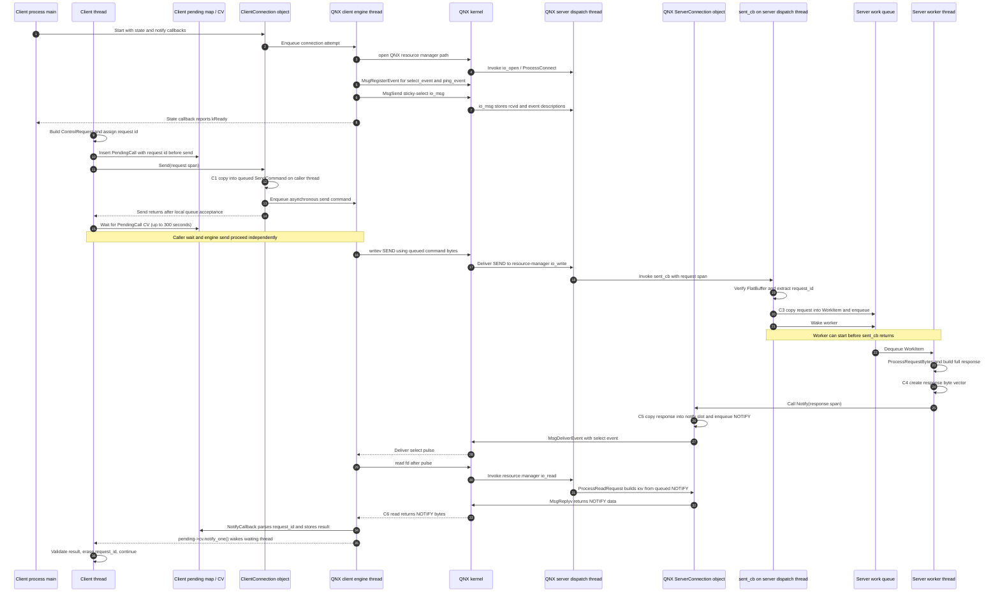
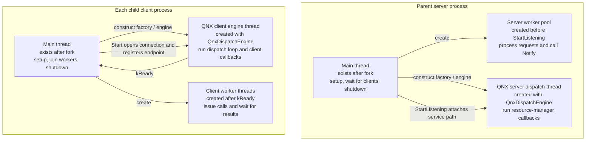
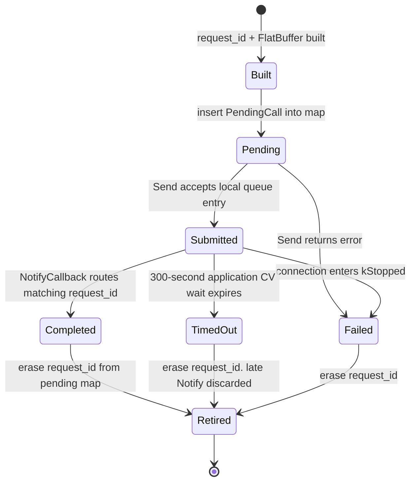
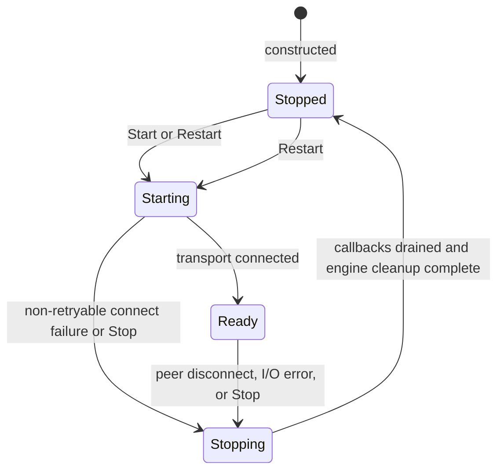

<!-- ----------------------------------------------------------------------------
  Copyright (c) 2026 Contributors to the Eclipse Foundation

  See the NOTICE file(s) distributed with this work for additional
  information regarding copyright ownership.

  This program and the accompanying materials are made available under the
  terms of the Apache License Version 2.0 which is available at
  https://www.apache.org/licenses/LICENSE-2.0

  SPDX-License-Identifier: Apache-2.0
----------------------------------------------------------------------------- -->

# score::message_passing No-Reply POC and QNX Usage Overview

## Scope

This document describes the low-level no-reply POC in [poc_low_level_no_reply.cpp](poc_low_level_no_reply.cpp) and the `score::message_passing` implementation selected by the platform build. The dependency is `score_communication` version `0.5.0`, as declared in [MODULE.bazel](../../../MODULE.bazel).

The public API is platform-independent. `client_factory.h` selects `QnxDispatchClientFactory` and `QnxDispatchEngine` when `__QNX__` is defined; otherwise it selects `UnixDomainClientFactory` and `UnixDomainEngine`.

## Executive Summary

| Concern | Linux | QNX |
|---|---|---|
| Transport | Unix-domain `SOCK_STREAM` socket | QNX resource-manager path and message-passing events |
| Client engine | One `UnixDomainEngine` background thread per engine | One `QnxDispatchEngine` dispatch thread per engine |
| Server engine | One engine thread polls the listening socket and client sockets | One dispatch thread runs `dispatch_block()` / `dispatch_handler()` |
| Application workers | POC-owned server worker pool performs the request | Same POC-owned worker pool performs the request |
| Client send path | `Send()` copies into a queued send slot, then engine calls `sendmsg(SEND)` | `Send()` copies into a queued send slot, then engine calls `writev(SEND)` |
| Server receive path | Engine receives `SEND` and invokes `sent_cb` with a span | Resource-manager `io_write` invokes `sent_cb` with a span |
| Application `Reply()` | Not used; `SEND` has no application-level reply | Not used; `SEND` has no application-level reply |
| `Notify()` | `sendmsg(NOTIFY)` from the worker thread; it can block in the socket layer | Worker calls `Notify()`, which copies into a preallocated slot and signals the client with `MsgDeliverEvent`; the payload is returned later through `io_read` / `MsgReplyv`; returns `ENOBUFS` when the per-connection pool is full |
| Peer disconnect | EOF or `EPIPE` transitions the client to `kStopping` | QNX connection-death pulse or read failure transitions the client to `kStopping` |

The POC uses one request path and one terminal result path:

1. A client thread inserts a `PendingCall` keyed by `request_id`, then submits the request with `Send()`.
2. The server's `sent_cb` validates and copies the request into the POC work queue, then returns. A worker performs the work and sends the only application-level result with `Notify()`.

There is no application acknowledgement. A successful `Send()` means the request was accepted by the client's local asynchronous send queue, not that the server admitted or completed it. The client learns the outcome only from the matching `Notify()`, a connection-stop callback, or its 300-second wait timeout.

## Diagram 1: POC QNX Deployment and Call Flow

The process layout is created by `fork()`: the parent is the server and each child is a client. IPC objects are created after the fork. Each client process has one shared connection for all of its client threads.

### QNX copy and lifetime rules

- The span passed to `Send()` or `Notify()` is a borrowed view. The caller owns the source bytes.
- `ClientConnection::TryQueueMessage()` copies a client request into a library-owned `SendCommand.message`. With `truly_async=true`, `Send()` returns after this local queue copy; the engine sends it later.
- `ServerConnection::Notify()` copies the response into one of the preallocated `notify_storage_` slots. The slot is returned to `notify_pool_` only after the queued message has been delivered.
- The QNX resource manager and kernel perform the process-boundary transport. The callback receives a span valid for the callback invocation; it must not retain that span.
- The POC performs another application copy when it stores the received request in `WorkItem::request_bytes`. This is necessary because the worker runs after `sent_cb` returns.
- The POC's worker creates a separate response vector. It is then copied again by `Notify()` into the QNX notify pool.
- `max_queued_notifies = T` covers up to `T` responses waiting for delivery when each client thread has at most one normally progressing call. It is not a hard bound after timeouts: a timed-out client thread can send another request while its earlier server work is still running, and the old work may later call `Notify()`. If the pool is exhausted, `Notify()` returns `ENOBUFS`; that request has no terminal result at the client.

### Queue sizing and bounds

The POC uses `N` for the expected number of client processes and `T` for the maximum number of calling threads, and it configures:

- Client `max_queued_sends = T`, `max_async_replies = 0`, and `truly_async = true`. `max_queued_sends` preallocates the client's asynchronous send slots; no reply-callback slots are needed for `Send()`.
- Server `pre_alloc_connections = N` and `max_queued_notifies = T`.
- Server `max_queued_sends = N`.

The client and server fields named `max_queued_sends` configure different queues. The client `ClientConfig.max_queued_sends` contributes to `ClientConnection::send_storage_` alongside `max_async_replies`; in this POC, `max_async_replies=0`, so the client has `T` preallocated send slots. The server `ServerConfig.max_queued_sends` is intended to bound incoming `SEND` messages; its current implementation status is described under [Current Limitations](#current-limitations).

### QNX threading view

### QNX delivery and failure semantics

- Before any notification can be delivered, the client engine registers `select_event_` and `ping_event_` with `MsgRegisterEvent()` and sends a sticky-select `io_msg`. The server stores the resulting `rcvid_` and event descriptions on the `ServerConnection`.
- `Notify()` queues the application response on the server connection. `MsgDeliverEvent()` delivers a pulse that wakes the client engine; it does not carry the response payload.
- After the pulse, the client calls `read(fd)`. The QNX resource manager invokes `io_read`, which calls `ProcessReadRequest`; that method uses `MsgReplyv()` to return the queued protocol code and bytes to the client read.
- `Notify()` can fail with `EMSGSIZE` for an oversized response or `ENOBUFS` when the per-connection notify pool is exhausted. A successful return means the response was accepted into the server queue, not that the client callback has completed.
- The implementation ignores the return values of `MsgDeliverEvent()` and `MsgReplyv()`. Pulse delivery, client read, or queued-read completion can therefore fail after `Notify()` has returned successfully; the client may then stop or time out.
- `SEND` does not wait for an application-level reply, so there is no REQUEST/REPLY window holding up the next request. Server callbacks for a session are still serialized by the public API contract, but the POC callback only validates, copies, queues, and returns; worker threads perform the operations concurrently.
- Invalid requests do not receive a correlated error `Notify()` in this POC. QNX `io_write` currently ignores the boolean result from `ProcessInput()` and returns `EOK`; consequently, a callback error is not an application-level rejection delivered to the sender. Depending on transport behavior, the waiting call can be failed by connection stop or remain pending until its 300-second timeout.

## Request and Connection State Models

### POC request state

There is no acknowledgement state. `Send()` acceptance is only local submission. `NotifyCallback` sets the result and wakes the caller when it can parse and route a response. In the POC, a malformed notification may not yield a usable `request_id`; that notification is not matched to a pending call, which can then time out. On connection stop, the callback clears the map and wakes all pending calls as failures.

### Library connection state

### Server-side request lifecycle

```mermaid
stateDiagram
    [*] --> Received: io_write receives SEND
    Received --> Validated: verify FlatBuffer + request_id
    Validated --> WorkQueued: copy request into WorkItem
    Validated --> Rejected: invalid request; no correlated error Notify
    WorkQueued --> Processing: wake worker
    Processing --> NotifyQueued: Notify response
    NotifyQueued --> Delivered: pulse, read, and MsgReplyv complete
    NotifyQueued --> Dropped: EMSGSIZE, ENOBUFS, disconnect, or delivery failure
    Delivered --> [*]
    Dropped --> [*]
    Rejected --> [*]

```

## Linux versus QNX: What the POC Can Assume

The application-level flow and state model are the same on both platforms. The important portability boundaries are:

1. **The asynchronous send guarantee is configuration-dependent.** The POC sets `truly_async=true` and `max_queued_sends=T`; client call threads copy into preallocated library-owned send slots, while the engine performs the transport write. `max_async_replies` is zero because this POC does not use `SendWithCallback()`.
2. **The server worker lifetime guard is required on both platforms.** A worker stores a raw `IServerConnection*`; the POC pairs it with a per-connection `shared_ptr<bool>` and holds the live-connection mutex across the check and `Notify()` call.
3. **Queue capacities are platform-specific.** QNX uses `max_queued_notifies` to preallocate per-connection notify slots. The server `max_queued_sends` and Unix-domain `ServerConfig` limitation is described under [Current Limitations](#current-limitations).
4. **`Notify()` has different backpressure behavior.** QNX can return `ENOBUFS` when its notify pool is exhausted; Linux calls `sendmsg()` synchronously and may block under socket backpressure. See [Current Limitations](#current-limitations) for the effects on worker and disconnect handling.
5. **The public connection state is richer than the POC's ready/stopped handling.** The library exposes `kStarting`, `kReady`, `kStopping`, and `kStopped`; the POC waits for `kReady` and observes `kStopped`, while the intermediate transitions remain library-internal to the POC.

## Current Limitations

- **Server ingress capacity is not established by the configured queue field.** `IServerFactory::ServerConfig.max_queued_sends` is documented as server-side SEND queue capacity, and the dependency requirement describes a shared incoming ring buffer. The checked-out QNX server stores `ServerConfig` but does not read `max_queued_sends`; it uses `max_queued_notifies` to size per-connection notification slots. `UnixDomainServer` ignores `ServerConfig`. Therefore, the POC's server `max_queued_sends=N` does not establish a bounded ingress queue in either backend. This is distinct from the client `ClientConfig.max_queued_sends`, which is used to size `ClientConnection::send_storage_`.
- **Linux does not preserve access-denied errors from the server connect callback.** If `UnixDomainServer::ProcessConnect()` receives an error from `connect_cb`, it does not propagate that error to the client; the rejected server connection is destroyed and its accepted socket is closed. The client's socket `connect()` may already have succeeded, so it observes the peer close instead. `ClientConnection` maps the resulting `EPIPE` to `StopReason::kClosedByPeer`, not `kPermission`; therefore the client cannot distinguish access denial from an ordinary peer disconnect through the stop reason. `kPermission` is assigned when the OS itself returns `EACCES` during connection establishment.
- **QNX resource-manager input size is hard-coded to 2088 bytes.** `QnxDispatchEngine::InitServerThread()` sets `resmgr_attr.msg_max_size = 2088U`. [Issue #848](https://github.com/eclipse-score/communication/issues/848) reports that larger incoming messages are reproducibly discarded even when the client `max_send_size` is configured higher. In the checked-out source, `io_write` reads the incoming message from the resource-manager-provided buffer; `resmgr_msgget()` is used by `io_msg` for sticky-select registration, not to retrieve the request payload. Treat 2088 bytes as the incoming resource-manager message ceiling, not as guaranteed application payload capacity: transport framing consumes part of that size. Larger payloads need a verified fix and QNX integration test.
- **Linux `Notify()` has no bounded completion time.** `UnixDomainServer::ServerConnection::Notify()` synchronously calls `UnixDomainEngine::SendProtocolMessage()` from the worker. The engine calls `sendmsg()` on the accepted `SOCK_STREAM` socket without `MSG_DONTWAIT` or a configured send timeout. If a peer stays connected but stops draining its socket and the send buffer fills, `Notify()` can remain blocked for an unbounded duration. The client's 300-second wait timeout limits only the caller's wait; it does not cancel the server's send. In this POC, the worker holds `live_conn.mutex` across `Notify()`, so a blocked send also delays the disconnect callback and connection cleanup/admission.

## To be considered for proper impl:

- POC focuses mainly on the good path. Basic errors checks are implemented, but they are not yet sufficient or thorough enough.
- Define the config parameter values (number of threads, ... , size of transferred elements)
  - Enforce configuration consistently: number of clients (`N`), concurrent requests per client (`T`), maximum payload (`M`), worker count, transport queue depths, application work-queue depth
- Make timeout mandatory and passed by called -> Interface change?
- Make SerDe lib exchangable
- Think about connection policy e.g. one connection per UID or N per UID. Ideally switchable
    - Or bring out the admission call to allow custom behaviour
- Use proper state machines for connection state, pending request state and work item state
- Use base-libs thread pools
- Job cancellation is implemented as cooperative cancellation.
    - The client sends a cancellation request but keeps the original pending request until a final completion notification arrives.
    - Queued work can produce a final cancelled response; running work receives a stop token and its handler result remains authoritative.
    - If cancellation cannot be resolved before the deadline or connection loss, the client returns the typed `kOperationCancelledMayExecute` outcome.
    - Cancellation and shutdown behavior for queued and in-flight work, client disconnects, server termination, and worker teardown is implemented, but provider-level interruption remains handler-dependent.
    - Need to also think how to properly give preference to "cancel requests" and if they need to be handled differently than normal ones
- Bound the application work queue and define admission behavior when it is full. Since `SEND` has no application acknowledgement, define how overload is reported (for example, a correlated terminal error notification or connection failure) and ensure queue admission/resource reservation is explicit.
- Define authenticated peer identity, endpoint permissions, authorization, and behavior for rejected or reconnecting clients.
- Define what happens when a terminal `Notify()` is lost after work has been admitted. A client timeout does not prove the operation did not execute; define typed "may have executed" outcomes, idempotency/deduplication, and retry rules for non-idempotent operations.
